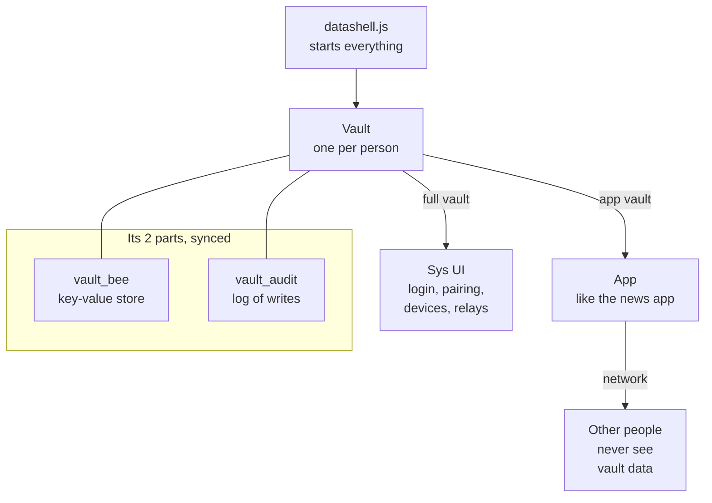
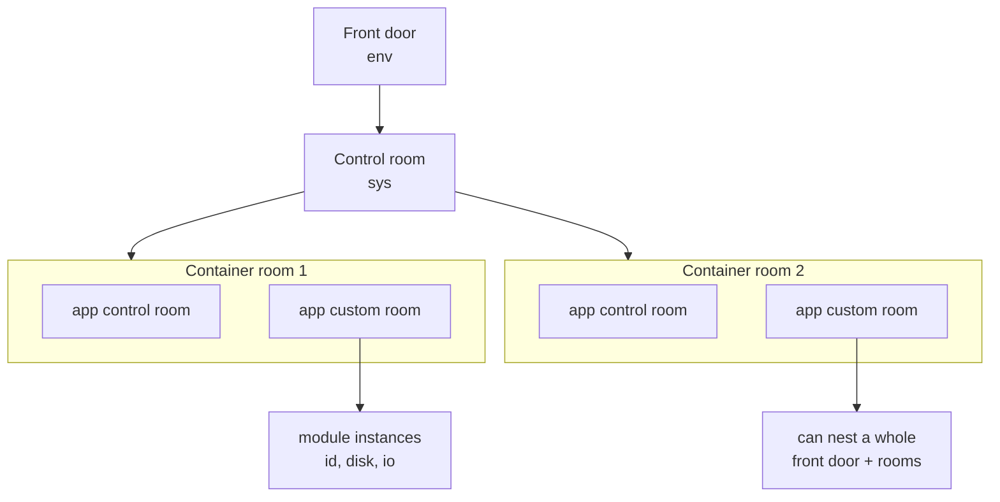
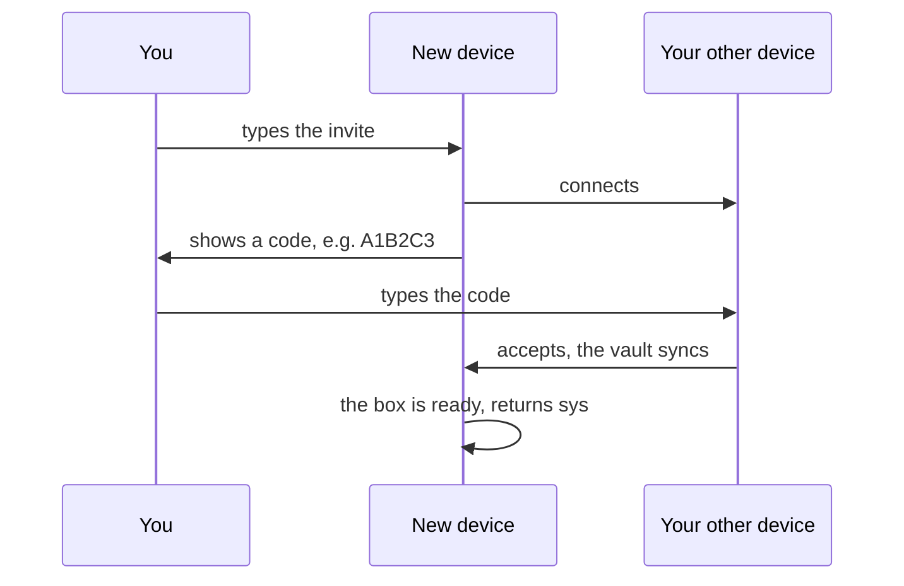
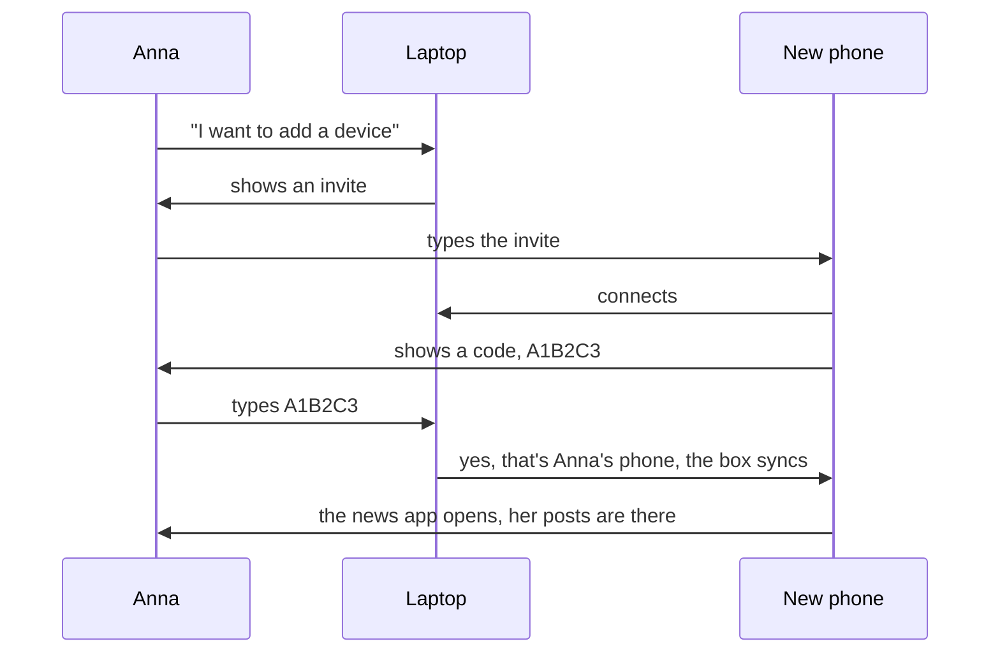

# P2P Datashell Vault API

Two parts: **what exists today** (grouped, as it is in the code right now) and an **[ideal API (draft)](#ideal-api-draft)** to work towards. Click a method to see more.

Code: [af44n/p2p-news-app @ `9df9773`](https://github.com/af44n/p2p-news-app/tree/9df97736c4612ebd4ff19c6f5e8447a12e52bed2)

---

## How to think about it

- **Datashell opens one vault per person.** That's one per browser origin, or one per folder on the command line.
- **It runs two things:**
  - **the sys UI**, which gets the **full vault**
  - **one app**, which gets a smaller **app vault**
- **The vault itself is just 2 things that sync to all your own devices:**
  - **`vault_bee`**: a key-value store that holds all records
  - **`vault_audit`**: a log of every write

**In one picture**



[Entry point: datashell.js](https://github.com/af44n/p2p-news-app/blob/9df97736c4612ebd4ff19c6f5e8447a12e52bed2/lib/datashell.js#L59-L82): it creates the vault, runs the sys UI, waits for `vault.user`, then starts the app with the app vault.

**System vault vs app vault**

| | System vault (sys UI) | App vault (e.g. the news app) |
|---|---|---|
| Gets | everything | its own small slice |
| Data keys | as written | auto-prefixed with `<profile>:<app>/` |
| Storage (`store`) | the whole vault store | a separate namespace for this app |
| Meant for | login, pairing, devices, relays, profiles | its own data, data structures, networking |
| Extra | | `username` (the profile name), `app_state` (an object kept while the page is open) |

**Labels used below:** *(env UI)* = the first screen, before login (new account, pair, restore) · *(sys UI only)* = only the sys UI gets it · *(apps)* = apps get it too

> An app only gets the methods labelled *(apps)*, plus `username`, `store` and `app_state`. Everything else is for the sys UI only.

[Where the vault is created](https://github.com/af44n/p2p-news-app/blob/9df97736c4612ebd4ff19c6f5e8447a12e52bed2/lib/node_modules/identity/index.js#L80-L160) · [Where the app vault is made](https://github.com/af44n/p2p-news-app/blob/9df97736c4612ebd4ff19c6f5e8447a12e52bed2/lib/datashell.js#L97-L126)

---

## 1. Login *(env UI)*

**Open the vault on this device, or join one from another device.** The sys UI also uses `session_*` and `reset_all_data()`, e.g. for logout and reset.

<details>
<summary><code>authenticate({ username, invite_code?, on_verification_code?, defer_resolve? })</code>: log in, or join with an invite</summary>

- **Without `invite_code`:** opens this device's vault, or creates a new one.
- **With `invite_code`:** joins the vault of another device. `on_verification_code(code)` then gives a 6-character code to type on the other device.
- **With `defer_resolve: true`:** `user` only resolves after `complete_authentication()`, e.g. once the user picked an app.

```js
vault.authenticate({ username: 'anna' })
const my_vault = await vault.user
```
[source](https://github.com/af44n/p2p-news-app/blob/9df97736c4612ebd4ff19c6f5e8447a12e52bed2/lib/node_modules/identity/index.js#L168-L226)
</details>

<details>
<summary>Join with an invite: the new device's side of pairing</summary>

The new device has no vault yet, so it joins from the env UI with the invite code from the existing device. It shows a 6-character code, the existing device types it in, and then the vault syncs.

```js
vault.authenticate({ username: 'pairing-user', invite_code, on_verification_code: code => show(code) })
vault.on_vault_ready(() => show_app_picker())   // then complete_authentication() once an app is picked
const my_vault = await vault.user
```
[source](https://github.com/af44n/p2p-news-app/blob/9df97736c4612ebd4ff19c6f5e8447a12e52bed2/lib/node_modules/identity/index.js#L171-L197)
</details>

<details>
<summary><code>user</code>: a promise that gives you the vault once login is done</summary>

It resolves to the vault object, and fails if login or pairing failed. It only resolves once, so a new login needs a page reload.

```js
const my_vault = await vault.user
vault.user.catch(err => alert('Login failed: ' + err.message))
```
[source](https://github.com/af44n/p2p-news-app/blob/9df97736c4612ebd4ff19c6f5e8447a12e52bed2/lib/node_modules/identity/index.js#L67-L71)
</details>

<details>
<summary><code>on_vault_ready(cb)</code>: called when the vault is open, before <code>user</code> resolves</summary>

The sys UI uses this to show the app picker first. Call `complete_authentication()` afterwards.

```js
vault.on_vault_ready(({ username }) => show_app_picker())
vault.authenticate({ username: 'anna', defer_resolve: true })
```
[source](https://github.com/af44n/p2p-news-app/blob/9df97736c4612ebd4ff19c6f5e8447a12e52bed2/lib/node_modules/identity/index.js#L483)
</details>

<details>
<summary><code>complete_authentication()</code>: finish login, so <code>user</code> resolves</summary>

Used after pairing, or after the user picked an app.

```js
vault.session_set_joined_app('anna:p2p-news-app')
vault.complete_authentication()
```
[source](https://github.com/af44n/p2p-news-app/blob/9df97736c4612ebd4ff19c6f5e8447a12e52bed2/lib/node_modules/identity/index.js#L228-L232)
</details>

<details>
<summary><code>session_*</code> (8 functions): small things this device remembers in localStorage</summary>

- `session_get/set_username`
- `session_get/set_joined_app`: the profile this device opened last, e.g. `anna:p2p-news-app`
- `session_get/set/clear_pending_invite`: the invite code of a device that is in the middle of pairing
- `session_clear()`: clears all of localStorage

They're in localStorage because they're per device and needed before the vault is open. **Planned:** `joined_app` moves into the vault.

```js
vault.session_set_joined_app('anna:p2p-news-app')
const last_profile = vault.session_get_joined_app()
```
[source](https://github.com/af44n/p2p-news-app/blob/9df97736c4612ebd4ff19c6f5e8447a12e52bed2/lib/node_modules/identity/index.js#L488-L495)
</details>

<details>
<summary><code>reset_all_data()</code>: delete everything on this device</summary>

Clears localStorage and the browser storage of the vault.

```js
await vault.reset_all_data()
location.reload()
```
[source](https://github.com/af44n/p2p-news-app/blob/9df97736c4612ebd4ff19c6f5e8447a12e52bed2/lib/node_modules/identity/index.js#L500-L504)
</details>

<details>
<summary>Notes: one identity per browser, mnemonic</summary>

- **One identity per browser origin for now.** Multiple accounts per browser may come later.
- **The mnemonic:** today each device makes its own mnemonic and keeps it in localStorage. This will change with mnemonic recovery: long term, only its public key stays on the device.
- **"Load from mnemonic"** is not built yet.
</details>

---

## 2. Pairing *(sys UI + env UI)*

**Add a new device to your vault.** Pairing has two sides:

- **Existing device (sys UI):** adds a new device and shares an invite code. The methods below are this side.
- **New device (env UI):** starts pairing with the invite code, see "Join with an invite" in 1. Login.

Steps: device A creates an invite → device B enters it → B shows a code → A types the code → B is added.

If pairing fails or is cancelled, device B deletes everything it had, so it can start fresh.

<details>
<summary><code>create_vault_invite()</code>: make an invite code on device A</summary>

Returns `{ invite_code, invite }`. The invite is saved in the vault, so it survives a page reload.

```js
const { invite_code, invite } = await vault.create_vault_invite()
```
[source](https://github.com/af44n/p2p-news-app/blob/9df97736c4612ebd4ff19c6f5e8447a12e52bed2/lib/node_modules/identity/index.js#L336-L352)
</details>

<details>
<summary><code>setup_vault_pairing({ invite, username, on_verification_needed, on_paired })</code>: wait for device B to connect</summary>

`on_verification_needed` fires when B connects (show the code input). `on_paired` fires when B is added.

```js
await vault.setup_vault_pairing({
  invite,
  username: 'anna',
  on_verification_needed: () => show_code_input(),
  on_paired: ({ vault_bee_writer }) => console.log('added', vault_bee_writer)
})
```
[source](https://github.com/af44n/p2p-news-app/blob/9df97736c4612ebd4ff19c6f5e8447a12e52bed2/lib/node_modules/identity/index.js#L354-L359)
</details>

<details>
<summary><code>verify_vault_pairing(code)</code>: confirm device B with the code it shows</summary>

Adds B to the vault. Throws if the code doesn't match; the sys UI then shows the error and lets you try again.

```js
try { await vault.verify_vault_pairing('A1B2C3') }
catch (err) { alert(err.message) } // wrong code: try again
```
[source](https://github.com/af44n/p2p-news-app/blob/9df97736c4612ebd4ff19c6f5e8447a12e52bed2/lib/node_modules/identity/index.js#L361-L366)
</details>

<details>
<summary><code>deny_vault_pairing()</code>: reject device B</summary>

Throws if no request is waiting, on purpose. The UI only shows Deny once a request has come in.

```js
try { vault.deny_vault_pairing() } catch (err) { alert(err.message) }
```
[source](https://github.com/af44n/p2p-news-app/blob/9df97736c4612ebd4ff19c6f5e8447a12e52bed2/lib/node_modules/identity/index.js#L368-L372)
</details>

<details>
<summary><code>cancel_vault_invite()</code>: stop pairing and delete the invite</summary>

```js
await vault.cancel_vault_invite()
```
[source](https://github.com/af44n/p2p-news-app/blob/9df97736c4612ebd4ff19c6f5e8447a12e52bed2/lib/node_modules/identity/index.js#L399-L407)
</details>

<details>
<summary><code>restore_pending_invites(config)</code>: after a reload on device A, keep waiting for B</summary>

```js
const stored = await vault.restore_pending_invites({
  username: 'anna',
  on_verification_needed: () => show_code_input(),
  on_paired: ({ vault_bee_writer }) => console.log('added', vault_bee_writer)
})
if (stored) show(stored.invite_code)
```
[source](https://github.com/af44n/p2p-news-app/blob/9df97736c4612ebd4ff19c6f5e8447a12e52bed2/lib/node_modules/identity/index.js#L378-L392)
</details>

---

## 3. Devices *(sys UI only)*

**See and manage your own devices.**

<details>
<summary><code>get_paired_devices()</code>: list your devices</summary>

Each device has a name and the time it was last online.

```js
const devices = await vault.get_paired_devices()
for (const d of devices) console.log(d.name, new Date(d.last_online))
```
[source](https://github.com/af44n/p2p-news-app/blob/9df97736c4612ebd4ff19c6f5e8447a12e52bed2/lib/node_modules/identity-operations/index.js#L206-L214)
</details>

<details>
<summary><code>get_device_name(writer_key)</code>: get one device's name</summary>

```js
const name = await vault.get_device_name(writer_key) // 'Device 2' or null
```
[source](https://github.com/af44n/p2p-news-app/blob/9df97736c4612ebd4ff19c6f5e8447a12e52bed2/lib/node_modules/identity-operations/index.js#L216-L221)
</details>

<details>
<summary><code>remove_device(device)</code>: remove a device from your vault</summary>

Takes the device object from `get_paired_devices()`. The removed device can't write anymore, and it deletes its own data when it notices.

```js
const ok = await vault.remove_device(device) // true or false
```
[source](https://github.com/af44n/p2p-news-app/blob/9df97736c4612ebd4ff19c6f5e8447a12e52bed2/lib/node_modules/identity-operations/index.js#L223-L249)
</details>

<details>
<summary>rename a device: no method, done with <code>vault_put</code></summary>

```js
await vault.vault_put(`paired_devices/${device.vault_bee_writer}`, { ...device, name: 'My Phone' })
```
</details>

<details>
<summary><code>ping_liveness()</code>: mark this device as online now</summary>

Updates `last_online`. The sys UI uses it to find devices that were offline for a long time, and decides itself what to do with them.

```js
await vault.ping_liveness()
```
[source](https://github.com/af44n/p2p-news-app/blob/9df97736c4612ebd4ff19c6f5e8447a12e52bed2/lib/node_modules/identity-operations/index.js#L261-L269)
</details>

<details>
<summary><code>on_malicious_device(cb)</code>: called when a device writes a fake log entry</summary>

`cb(writer_key)`. The sys UI then asks whether to remove that device.

```js
vault.on_malicious_device(async writer_key => {
  const devices = await vault.get_paired_devices()
  const device = devices.find(d => d.vault_audit_writer === writer_key || d.app_audit_writer === writer_key)
  if (device && confirm('Remove ' + device.name + '?')) await vault.remove_device(device)
})
```
[source](https://github.com/af44n/p2p-news-app/blob/9df97736c4612ebd4ff19c6f5e8447a12e52bed2/lib/node_modules/identity/index.js#L482)
</details>

---

## 4. Data *(apps)*

**An app's own small data: settings, lists, small records.** Keys are prefixed with the profile + app, everything syncs to your devices, and every write is logged.

<details>
<summary><code>vault_put(key, value)</code>: save a value</summary>

The value must be JSON. The write is added to the vault log.

```js
await vault.vault_put('subscribed_peers', ['ab12…'])
```
[source](https://github.com/af44n/p2p-news-app/blob/9df97736c4612ebd4ff19c6f5e8447a12e52bed2/lib/node_modules/identity-operations/index.js#L145-L153)
</details>

<details>
<summary><code>vault_get(key)</code>: read a value</summary>

Returns the value, or `null` if nothing is stored. Reads are not logged.

```js
const peers = await vault.vault_get('subscribed_peers') || []
```
[source](https://github.com/af44n/p2p-news-app/blob/9df97736c4612ebd4ff19c6f5e8447a12e52bed2/lib/node_modules/identity-operations/index.js#L155-L160)
</details>

<details>
<summary><code>vault_del(key)</code>: delete a value</summary>

```js
await vault.vault_del('subscribed_peers')
```
[source](https://github.com/af44n/p2p-news-app/blob/9df97736c4612ebd4ff19c6f5e8447a12e52bed2/lib/node_modules/identity-operations/index.js#L162-L170)
</details>

<details>
<summary><code>vault_watch(key)</code>: get notified when a value changes, also from other devices</summary>

Only on the app vault.

```js
for await (const _ of vault.vault_watch('subscribed_peers')) {
  const peers = await vault.vault_get('subscribed_peers')
}
```
[source](https://github.com/af44n/p2p-news-app/blob/9df97736c4612ebd4ff19c6f5e8447a12e52bed2/lib/datashell.js#L113)
</details>

<details>
<summary><code>on_update(cb)</code> <i>(sys UI only)</i>: called on any change in the vault</summary>

It gives no details about what changed, so re-read what you need. There is no way to unsubscribe yet.

```js
vault.on_update(() => render())
```
[source](https://github.com/af44n/p2p-news-app/blob/9df97736c4612ebd4ff19c6f5e8447a12e52bed2/lib/node_modules/identity/index.js#L481)
</details>

---

## 5. App structures *(apps)*

**Bigger data, like a feed or files.** The app creates them, and the vault remembers their keys so your other devices can find them.

<details>
<summary><code>store</code>: the app's own storage space</summary>

Data structures are created in here. Other apps' data is not in it.
</details>

<details>
<summary><code>create_ds_manager()</code> + <code>set_ds_manager(m)</code>: make the helper that creates the app's data structures</summary>

```js
const ds = vault.create_ds_manager()
vault.set_ds_manager(ds)
await ds.init_all([
  { name: 'feed', namespace: 'my-feed', type: 'autobase', encoding: 'json', view_name: 'feed-view', store: vault.store },
  { name: 'files', namespace: 'my-files', type: 'autodisk', store: vault.store }
], keys_or_null)
```
An `autobase` needs `encoding` and `view_name`. Without them, the feed has no view to read from and writers can't be added.
[source](https://github.com/af44n/p2p-news-app/blob/9df97736c4612ebd4ff19c6f5e8447a12e52bed2/lib/node_modules/datastructure-manager/index.js#L211-L225)
</details>

<details>
<summary>The structure helper's own methods (what <code>ds</code> can do)</summary>

| Method | What it does |
|---|---|
| `init_all(configs, keys?)` | create or open all structures at once (keys = open existing ones) |
| `register(config)` · `init(name, key?)` | the same, one structure at a time |
| `get(name)` | the structure itself, e.g. the feed |
| `get_key(name)` | its key, to open it on another device |
| `get_store(name)` | its own storage space |
| `get_names()` · `get_config(name)` · `get_all_configs()` | what's registered |
| `add_writer(name, key)` · `remove_writer(name, key)` | let a device write, or stop it (the vault does this for you) |
| `set(name, instance, key?)` | use a structure made somewhere else |
| `create_peer_structure({ name, peer_key, peer_key_buffer, store_instance })` | open someone else's structure to read it (autobase or autodisk) |

```js
const feed = ds.get('feed')
await feed.append({ type: 'post', data: { title: 'Hello' } })
const feed_key = ds.get_key('feed')
```
[source](https://github.com/af44n/p2p-news-app/blob/9df97736c4612ebd4ff19c6f5e8447a12e52bed2/lib/node_modules/datastructure-manager/index.js#L16-L36)
</details>

<details>
<summary><code>register_app(config)</code>: save the app and its structure keys in the vault</summary>

Called once, on the first device. It also creates the app's own log.

```js
await vault.register_app({
  name: 'My App',
  structures: [{ name: 'feed', namespace: 'my-feed', type: 'autobase', encoding: 'json', view_name: 'feed-view', key: ds.get_key('feed') }]
})
```
[source](https://github.com/af44n/p2p-news-app/blob/9df97736c4612ebd4ff19c6f5e8447a12e52bed2/lib/node_modules/identity-operations/index.js#L64-L87)
</details>

<details>
<summary><code>get_app()</code>: read the saved app record (or <code>null</code> the first time)</summary>

On another device, use it to open the same structures with the saved keys.

```js
const app = await vault.get_app()
const keys = app ? Object.fromEntries(app.structures.filter(s => s.key).map(s => [s.name, s.key])) : null
await ds.init_all(STRUCTURES.map(s => ({ ...s, store: vault.store })), keys) // keys null = create new
```
[source](https://github.com/af44n/p2p-news-app/blob/9df97736c4612ebd4ff19c6f5e8447a12e52bed2/lib/node_modules/identity-operations/index.js#L111-L116)
</details>

<details>
<summary><code>get_app_status()</code>: <code>'joined'</code>, <code>'pairing'</code> or <code>'available'</code> on this device</summary>

```js
const status = await vault.get_app_status()
if (status !== 'pairing') await vault.request_writer_access()
```
[source](https://github.com/af44n/p2p-news-app/blob/9df97736c4612ebd4ff19c6f5e8447a12e52bed2/lib/node_modules/identity-operations/index.js#L475-L480)
</details>

<details>
<summary>Writer access (3 functions): the second step of pairing, per app</summary>

A new device can read the app's data but can't write to it yet:
1. **B:** `request_writer_access()` asks for write access.
2. **A:** `start_writer_watcher()` sees the request and adds B as a writer.
3. **B:** `wait_for_writer_access()` resolves when B can write.

```js
if (feed.writable) vault.start_writer_watcher()
else { await vault.request_writer_access(); await vault.wait_for_writer_access() }
```
[source](https://github.com/af44n/p2p-news-app/blob/9df97736c4612ebd4ff19c6f5e8447a12e52bed2/lib/node_modules/identity-operations/index.js#L278-L443)
</details>

<details>
<summary><code>log_bootstrap_device()</code>: save this device's writer keys in the device list</summary>

```js
await vault.log_bootstrap_device()
```
[source](https://github.com/af44n/p2p-news-app/blob/9df97736c4612ebd4ff19c6f5e8447a12e52bed2/lib/node_modules/identity-operations/index.js#L446-L469)
</details>

<details>
<summary><code>list_apps()</code> <i>(sys UI only)</i> · <code>cancel_app_pairing(app_id)</code> <i>(sys UI only)</i>: for the sys UI's app picker</summary>

- `list_apps()` gives all apps and profiles in the vault.
- `cancel_app_pairing(app_id)` stops a waiting writer request.

```js
const apps = await vault.list_apps() // [{ id, status, name, structures }]
await vault.cancel_app_pairing('anna:p2p-news-app')
```
[source](https://github.com/af44n/p2p-news-app/blob/9df97736c4612ebd4ff19c6f5e8447a12e52bed2/lib/node_modules/identity-operations/index.js#L122-L139)
</details>

### Structure types

All four are **shared and multi-device**. They're built on Autobase, so every device ends up with the same data.

| Type | What it is | Use it for |
|---|---|---|
| **autobase** | a shared list of entries | feeds, timelines (the news feed) |
| **autodisk** | a shared folder of files | images, posts with files, packs of code |
| **autobee** | a shared key-value table | settings, records (the vault itself is one) |
| **auditcore** | a shared log that checks who wrote each entry | history, "who did what" (vault log, app logs) |

**Why more than one?** Data comes in different shapes: a list, files, a table, a history. Each type fits one shape.

**Can there be more types?** The basic ones (autobase, autodisk, autobee) stay part of datashell; auditcore is an autobase used as a log. Today all types are hard-coded, and whether apps can bring their own types later is still open.

**Built-in vs your own:** some structures every app gets automatically, like its audit log (`register_app` creates it). You only define your app's own extra structures, like a feed.

---

## 6. Network *(apps)*

**Talk to other people (not your own devices).**

<details>
<summary><code>network()</code>: get a connection to other people</summary>

Returns `{ swarm }` (`null` when offline). The app picks its own topic. Vault data is never shared on this network.

```js
const { swarm } = await vault.network()
if (swarm) swarm.join(MY_TOPIC, { server: true, client: true })
```
[source](https://github.com/af44n/p2p-news-app/blob/9df97736c4612ebd4ff19c6f5e8447a12e52bed2/lib/node_modules/identity-networking/index.js#L42-L85)
</details>

<details>
<summary>How connections work: relays in the browser only</summary>

- **Browsers can't connect peer-to-peer directly,** so they go through a WebSocket **relay**, and browser-to-browser connections fall back to WebRTC.
- **The command line and daemons** use the p2p network directly, with no relay.
- **Your own devices sync on a separate network,** which `authenticate` sets up.
</details>

<details>
<summary><code>get_current_relay()</code> <i>(sys UI only)</i> + relay settings: which relay the browser uses</summary>

The relay list and the default relay are saved in the vault. The sys UI's Relays tab edits them.

```js
const relay = vault.get_current_relay()
```
[source](https://github.com/af44n/p2p-news-app/blob/9df97736c4612ebd4ff19c6f5e8447a12e52bed2/lib/websys-ui.js#L604-L641)
</details>

---

## 7. Logs and debug

**See what happened, and inspect the raw data.**

<details>
<summary><code>get_vault_audit()</code> <i>(sys UI only)</i>: the vault's log of every write</summary>

```js
const entries = await vault.get_vault_audit().read()
```
[source](https://github.com/af44n/p2p-news-app/blob/9df97736c4612ebd4ff19c6f5e8447a12e52bed2/lib/node_modules/identity/index.js#L436)
</details>

<details>
<summary><code>get_app_audit()</code> · <code>load_app_audit(key)</code> <i>(apps)</i>: an app's own log</summary>

Each app has its own log of what it did.

```js
const app = await vault.get_app()
await vault.load_app_audit(app.audit_key) // on another device, once
const entries = await vault.get_app_audit().read()
```
[source](https://github.com/af44n/p2p-news-app/blob/9df97736c4612ebd4ff19c6f5e8447a12e52bed2/lib/node_modules/identity-operations/index.js#L93-L105)
</details>

<details>
<summary><code>get_raw_data(name)</code> <i>(apps)</i>: dump a data structure as text</summary>

For debugging.

```js
console.log(await vault.get_raw_data('feed'))
```
[source](https://github.com/af44n/p2p-news-app/blob/9df97736c4612ebd4ff19c6f5e8447a12e52bed2/lib/node_modules/identity-operations/index.js#L497-L504)
</details>

<details>
<summary><code>get_network_diagnostics()</code> · <code>get_performance_samples()</code> · <code>on_performance_sample(cb)</code> <i>(sys UI only)</i>: connection and speed info</summary>

Shown in the sys UI's Net and Performance tabs.

```js
const networks = vault.get_network_diagnostics()
vault.on_performance_sample(sample => draw(sample))
```
[source](https://github.com/af44n/p2p-news-app/blob/9df97736c4612ebd4ff19c6f5e8447a12e52bed2/lib/node_modules/identity/index.js#L460-L475)
</details>

<details>
<summary><code>set_events_drive</code> <i>(apps)</i> · <code>log_event</code>, <code>get_events</code>, <code>get_events_drive</code>, <code>get_events_store</code> <i>(sys UI only)</i>: older event log in an app's folder</summary>

Probably replaced by the audit logs over time.

```js
// app: hand its events folder to the vault
vault.set_events_drive(ds.get('events'), ds.get_store('events'))
// sys UI: write and read events
const drive = vault.get_events_drive()
await vault.log_event(drive, 'add', { name: 'Device 2' })
const events = await vault.get_events(drive)
```
[source](https://github.com/af44n/p2p-news-app/blob/9df97736c4612ebd4ff19c6f5e8447a12e52bed2/lib/node_modules/identity-operations/index.js#L176-L200)
</details>

---

## Internal: should not be public

These grew with the news app and were only meant for internal use. Apps don't get them.

<details>
<summary>9 internal getters, setters and helpers</summary>

| Method | What it gives or changes |
|---|---|
| `get_vault_bee()` | the raw key-value store of the whole vault |
| `get_swarm()` · `set_swarm()` | the network for your own devices |
| `get_dht()` · `set_dht()` | the low-level network |
| `get_ds_manager()` | the current app's structure helper |
| `set_pairing_manager()` | the pairing helper |
| `init_vault_structures()` | opens the vault's two parts (done by `authenticate`) |
| `config` | the options the vault was started with |

```js
const bee = vault.get_vault_bee() // sys UI only
```
[source](https://github.com/af44n/p2p-news-app/blob/9df97736c4612ebd4ff19c6f5e8447a12e52bed2/lib/node_modules/identity/index.js#L413-L438)
</details>

---

## Bugs

Still open in the latest code.

1. **Lowercase verification codes fail.** The code is shown in uppercase (`A1B2C3`), but the web UI and the CLI don't uppercase what the user types, so `a1b2c3` is rejected with "code does not match". [web](https://github.com/af44n/p2p-news-app/blob/9df97736c4612ebd4ff19c6f5e8447a12e52bed2/lib/websys-ui.js#L718) · [cli](https://github.com/af44n/p2p-news-app/blob/9df97736c4612ebd4ff19c6f5e8447a12e52bed2/lib/clisys-ui.js#L309)
2. **`get_current_relay()` can show the wrong relay.** It returns `config.relay || 'ws://localhost:8080'`, and `config.relay` is never set, so the Relays tab can show a different relay than the one in use. The connection itself is not affected. [source](https://github.com/af44n/p2p-news-app/blob/9df97736c4612ebd4ff19c6f5e8447a12e52bed2/lib/node_modules/identity/index.js#L438)
3. **Logout also deletes the device's seedphrase.** `session_clear()` empties all of localStorage, including `vault-seedphrase`, so the next login creates a new device key. The vault data stays. To confirm with Lupay, since the mnemonic work will change this part. [source](https://github.com/af44n/p2p-news-app/blob/9df97736c4612ebd4ff19c6f5e8447a12e52bed2/lib/websys-ui.js#L415)

---

## Ideal API (draft)

**An idea for a simpler vault API, to discuss and change step by step.** Some parts can only be decided once we try them in code. Click a method to see an example and what it replaces today.

<details>
<summary>The rules we follow (7)</summary>

1. **A 5-year-old should understand the names.** Use everyday words: `devices`, `apps`, `list`, `rename`, `history`.
2. **Rooms inside rooms.** Each room only gets what it needs, and nothing else.
3. **Local first, p2p when needed.** Apps work offline with the same API. Datashell quietly makes things p2p only when you share, go online, or add a device.
4. **Few methods, each doing more.** Group them by what you want to do, not by how the code works.
5. **Each part only sees its own.** An app is a tree of modules and instances. Each one can create and change its own data structures, but never anyone else's. Some things stay internal, like the audit log, so everyone can check what each part did.
6. **Start from STATE.js.** Where STATE.js already works well, the vault follows it. But STATE.js isn't finished either, so it can change too.
7. **Every flow can resume.** The page can reload or the computer can crash at any step. Every flow (pairing, login, setup) must be able to continue where it stopped.
</details>

### How it should look: rooms inside rooms

- **Front door (env):** before anything exists. Make a new **box** (your own virtual device), pair with your other device, or load a box you already have. Later there can be several boxes or accounts, protected by a seed phrase or password.
- **Control room (sys):** the admin room of your box, like a wallet. Your devices, apps and history.
- **Container rooms:** one for every app that runs, and many can run side by side. Each one has two parts:
  - **app control room:** the app's own private part, run by datashell: its history, its metadata, which devices may write.
  - **app custom room:** the app itself.
- **Inside the app:** the app is a tree of modules and instances (like the STATE.js news app). Each instance has its own `id`, `disk` (files) and `io` (talk to other parts).
- **Rooms can nest:** a container room can hold the whole thing again: its own front door, control room and container rooms.



| Room | Like… | What happens there | Gets |
|---|---|---|---|
| **Front door** | a hypervisor or login screen | make, pair or load a box | `env` |
| **Control room** | a wallet | manage devices, apps and history | `sys` |
| **App control room** | the app's own settings, run by datashell | its history, metadata, who may write | `app` |
| **App custom room** | the app itself | modules and instances doing the work | each instance's `sdb` (`id`, `disk`, `io`) |

<details>
<summary>What is built in, and what the app makes itself</summary>

- **Built in, made by datashell:** every app gets an audit log (its history) and some metadata. The app doesn't create them, and the control room can look at them.
- **Made by the app:** each instance has its own `sdb.disk`, a filesystem. If an app needs other kinds of data, it gets `sdb.db` to make its own (see open questions).
</details>

<details>
<summary>Where today's 7 groups go</summary>

| Today | Ideal room |
|---|---|
| 1. Login | front door |
| 2. Pairing | front door (new device) + control room (existing device) |
| 3. Devices | control room |
| 4. Data | each instance's `sdb` |
| 5. App structures | app control room (built in) + `sdb.disk` / `sdb.db` (the app's own) |
| 6. Network | a `.net` part (see the control room) |
| 7. Logs and debug | control room (whole box) + app control room (one app) |
</details>

In the current code these are `vault` (before login), `vault.user` and the app vault. Each instance's own `sdb` exists only in STATE.js, not in the vault yet.

### A. Front door *(env UI)*

**The front door shows what you can do just by looking at it.** Each method is one flow. When a flow is done, it gives you `sys`, the control room of that box.

```js
const datashell = window.datashell || require('datashell')
const env = datashell()
console.log(Object.keys(env))   // ['seed', 'pair', 'load', 'boxes']
```

<details>
<summary><code>env.seed({ name })</code>: make a new box</summary>

```js
const sys = await env.seed({ name: 'anna' })
```
**Flow:** make the box's keys → create its vault → save the box on this device → return `sys`.

**If it stops halfway:** calling `env.seed()` again continues instead of making a second box.

**Replaces:** `authenticate({ username })` + `await vault.user`. Hidden inside: `session_*`, `init_vault_structures`, `defer_resolve`.
</details>

<details>
<summary><code>env.pair({ invite, on_code })</code>: join a box from your other device</summary>

```js
const sys = await env.pair({ invite, on_code: code => show(code) })   // shows "A1B2C3"
```
**Flow:**



**If it stops halfway:** the invite is remembered, so calling `env.pair()` again after a reload continues.

**Replaces:** `authenticate({ username: 'pairing-user', invite_code, on_verification_code })` + `on_vault_ready` + `complete_authentication()`. The resume part is `pending_invite_code` today.
</details>

<details>
<summary><code>env.load({ words })</code>: bring a box back from its words (later)</summary>

```js
const sys = await env.load({ words })
```
**Flow:** type your words → find the box → sync it from your other devices → return `sys`.

**Replaces:** not built yet ("Load from mnemonic"). This will follow the mnemonic recovery work, where only the public key stays on the device.
</details>

<details>
<summary><code>env.boxes()</code>: the boxes on this device (later)</summary>

```js
const boxes = await env.boxes()
const sys = await boxes[0].open({ password })
```
Like a hypervisor with virtual machines: each box is its own virtual device. You can only open, change or delete boxes you own.

**Replaces:** nothing yet. Today there is one box per browser origin.
</details>

### B. Control room *(sys UI)*

**Everything about you and your devices.**

<details>
<summary><code>sys.devices.invite()</code>: let a new device join</summary>

```js
const invite = await sys.devices.invite()   // invite.code: give this to the new device
await invite.accept('A1B2C3')                 // or invite.reject() / invite.cancel()
```
**If the page reloads before `accept`:** `sys.devices.invites()` lists the open invites, so you can continue one.

**Replaces:** `create_vault_invite()` + `setup_vault_pairing()` + `verify_vault_pairing()` / `deny_vault_pairing()` / `cancel_vault_invite()`. Hidden: `restore_pending_invites()`. `accept` also takes lowercase codes.
</details>

<details>
<summary><code>sys.devices.list()</code>: see your devices</summary>

```js
const devices = await sys.devices.list()
```
**Replaces:** `get_paired_devices()` · `get_device_name()`.
</details>

<details>
<summary><code>sys.devices.rename(device, name)</code>: give a device a name</summary>

```js
await sys.devices.rename(device, 'My Phone')
```
**Replaces:** `vault_put('paired_devices/…', { ...device, name })`.
</details>

<details>
<summary><code>sys.devices.remove(device)</code>: take a device out</summary>

```js
await sys.devices.remove(device)
```
**Replaces:** `remove_device(device)`. (`ping_liveness()` stays hidden too: it runs on its own at every login.)
</details>

<details>
<summary><code>sys.apps.list()</code> · <code>open(id)</code> · <code>close()</code> · <code>reset(id)</code>: your apps and profiles</summary>

```js
const apps = await sys.apps.list()
await sys.apps.open('anna:p2p-news-app')
```
**Replaces:** `list_apps()` · `session_set_joined_app(id)` + `complete_authentication()` · `session_set_joined_app('')` + reload · deleting the app's records by hand. Hidden: `cancel_app_pairing()`.
</details>

<details>
<summary><code>sys.net</code>: everything about the network</summary>

```js
const info = sys.net.status()                  // connections, peers
await sys.net.relay('wss://my-relay.example')  // browser only: pick a relay
```
Relays are only needed because browsers can't do real p2p. Native apps don't need them, so they stay out of the core API, as one browser-only option inside `.net`.

**Replaces:** `get_network_diagnostics()` · `get_performance_samples()` · `vault_get/put('config/relays' …)` · `get_current_relay()`.
</details>

<details>
<summary><code>sys.history()</code>: who did what, on which device</summary>

```js
const entries = await sys.history()
```
**Replaces:** `get_vault_audit().read()`.

This is the **whole vault's** history. Apps have their own `sys.history()` with only **that app's** history (see the app room).
</details>

<details>
<summary><code>sys.on(message => …)</code>: one handler for everything that happens</summary>

```js
sys.on(message => {
  if (message.type === 'danger') ask_to_remove(message.data.device)   // always handle this one
  if (message.type === 'change') render()
})
```
One handler instead of many, because some messages must always be handled (like `danger`, a device writing fake entries). Each message has a `type` and `data`.

**Replaces:** `on_update(cb)` · `on_malicious_device(cb)` · `on_performance_sample(cb)`. (`on_vault_ready` is part of the front-door flows now.)
</details>

<details>
<summary><code>sys.reset()</code>: delete everything on this device</summary>

```js
await sys.reset()
```
**Replaces:** `reset_all_data()`.
</details>

### C. App room *(app UI)*

**An app gets two things:** `app`, its app control room (run by datashell), and for every module instance its own `sdb` (from STATE.js, as today).

<details>
<summary><code>app.data.put / get / del / on</code>: small data, like settings</summary>

```js
await app.data.put('theme', 'dark')
const theme = await app.data.get('theme')
await app.data.del('theme')
app.data.on('theme', value => render(value))
```
The same names as Hyperbee, the key-value store the vault already uses. Whether small data belongs to the whole app or to each instance's `sdb` is still open.

**Replaces:** `vault_put` · `vault_get` · `vault_del` · `vault_watch(key)` + a `for await` loop + `vault_get`.
</details>

<details>
<summary><code>sdb.disk</code>: each instance's own files</summary>

```js
const { sdb } = await get(sid)                       // STATE.js, as today
await sdb.disk.put('posts/1.json', JSON.stringify(post))
const file = await sdb.disk.get('posts/1.json')
const posts = await sdb.disk.list('posts/')
```
A filesystem for each module instance. It starts with the basics, roughly what `sdb.drive` already has, and later grows closer to Hyperdrive. The first time an instance uses it, it's created. On your other devices, the same instance opens the same files, and a new device can write too.

**Replaces:** autodisk via `create_ds_manager()` + `set_ds_manager()` + `init_all()`. Datashell does the rest by itself:
- `register_app()` / `get_app()`: remember the disk keys, so your other devices find the same disks
- `request_writer_access()` / `wait_for_writer_access()` / `start_writer_watcher()` / `get_app_status()`: let a new device write
- `log_bootstrap_device()`: record which device writes
- `namespace`, `encoding`, `view_name`, `store`: storage details
</details>

<details>
<summary><code>sdb.db</code>: build your own kind of data (advanced)</summary>

```js
const log = sdb.db.get('my-log')   // a raw append-only log, only for this instance
```
For apps that need something other than files. It's a corestore slice for this instance only, so it can't touch anyone else's data.

**Replaces:** the app vault's `store` (a corestore namespace for the whole app) and the hard-coded structure types.
</details>

<details>
<summary><code>app.history()</code>: the app's own history (built in)</summary>

```js
const entries = await app.history()
```
Every app gets one automatically. The app doesn't create it. It only shows **this app's** history, not the whole box's (that one is `sys.history()` in the control room).

**Replaces:** `get_app_audit().read()` · `load_app_audit(key)` · `set_events_drive()` and the events folder the app makes itself.
</details>

<details>
<summary><code>app.net</code>: talking to other people (not designed yet)</summary>

A placeholder. Before designing it, we first need to list what p2p networking can do (Lupay's `network()`, swarms, topics, protocols) and how that fits net.js and `io`, which STATE.js apps already use.

**Replaces:** `network()` + `swarm.join(topic)` with a 32-byte topic.
</details>

<details>
<summary>Packages and many copies of the same app</summary>

Every app is made from a **pkg** (package): a named disk with the app's code, with a `dat://` link behind the name. There can be **many copies of the same app**, each in its own container room and isolated from the others, e.g. `anna:p2p-news-app` and `bob:p2p-news-app`. How apps are installed and started from pkgs is still to work out.
</details>

<details>
<summary>Before and after: an app starting up</summary>

**Current code**, in the news app:

```js
const ds = vault.create_ds_manager()
vault.set_ds_manager(ds)
vault.start_writer_watcher()
const app = await vault.get_app()
if (app) {
  const keys = Object.fromEntries(app.structures.filter(s => s.key).map(s => [s.name, s.key]))
  await ds.init_all(STRUCTURES.map(s => ({ ...s, store: vault.store })), keys)
  if (!ds.get('metadata').writable) {
    if (await vault.get_app_status() !== 'pairing') await vault.request_writer_access()
    vault.wait_for_writer_access()
  }
} else {
  await ds.init_all(STRUCTURES.map(s => ({ ...s, store: vault.store })))
  await vault.register_app({ name: 'P2P News App', structures: /* ... */ })
}
vault.set_events_drive(ds.get('events'), ds.get_store('events'))
await vault.log_bootstrap_device()
const { swarm } = await vault.network()
```

**Idea:**

```js
const { sdb } = await get(sid)
await sdb.disk.put('posts/1.json', JSON.stringify(post))
```

**Where each part of the current code goes:**

| Current code | Idea |
|---|---|
| `create_ds_manager`, `set_ds_manager`, `init_all` | using `sdb.disk` opens it (created the first time) |
| `get_app`, `register_app` | datashell remembers and finds the disk keys |
| writer access (`request…`, `wait…`, `start_writer_watcher`, `get_app_status`) | datashell lets a new device write by itself |
| `set_events_drive`, `log_bootstrap_device` | built-in history and metadata |
| `network()` | `app.net`, not designed yet |

This is a direction, not a finished design. Each row still needs to be tried in code.
</details>

### Single player mode: local first

Datashell should also work **without the p2p part at all**: offline, on one device, with nothing to share. A calculator or a text editor might never need more.

- **Same API either way.** Apps use `sdb.disk`, `app.data` and `io` the same way, online or offline.
- **The upgrade happens only when it's needed:** when you make a link others can sync from, or connect to other devices (even your own). Then datashell turns the app's data and messages into real p2p ones in the background.
- **If the p2p part isn't installed,** that call throws an error.
- **The p2p part can be installed later,** probably from the control room: datashell gets the p2p bundle, keeps it in the browser, and loads it. (Today datashell already loads the sys UI and app bundles at runtime, and the p2p part is its own file, `shim.bundle.js`.)

### Questions and answers

<details>
<summary>1. What goes where?</summary>

- **Every app has an audit log:** datashell records what the app does, and the control room can check it.
- **Every app has some metadata,** also collected by datashell.
- **Each module instance has its own `sdb.disk`,** a filesystem. For most apps that's all they need.
- **Apps that need other kinds of data get `sdb.db`,** a corestore slice to make their own append-only logs.

Everything is built on append-only logs managed by corestore: `sdb.disk` uses 2 inside, the key-value store uses 1.
</details>

<details>
<summary>2. How do STATE.js's nested <code>sdb</code> map to the vault?</summary>

With nested corestore namespaces that copy the module tree. Each module gets its own slice inside its parent's slice, with its own `disk`:

```
root store
└─ sys
   ├─ app1
   │  └─ page.js (module)
   │     ├─ disk  →  sdb.disk
   │     └─ p2p-news-app (child module)
   │        └─ disk  →  sdb.disk
   └─ app2
```

```js
const sys_store = store.namespace('sys')
const app1_store = sys_store.namespace('app1')
const pageJS_module = app1_store.namespace('page.js')
sdb.disk = hyperdrive(pageJS_module.namespace('disk'))
```

Still to check: does a child module go under its parent's module slice (as in the tree), or under the parent's `disk`? And for syncing across your own devices, is it `hyperdrive` or `autodisk` (multi-writer)?
</details>

<details>
<summary>3. One disk per app, or one per component?</summary>

One per app, per module **and** per instance, like the STATE.js news app: every instance gets a `sid` and its own `sdb.disk`.
</details>

<details>
<summary>4. How does networking fit with net.js and <code>io</code>? (still open)</summary>

Not answered yet. First compare what net.js does today with what the vault's networking (`network()`) does, then brainstorm.
</details>

<details>
<summary>5. Where does the upgrade to p2p happen?</summary>

See "Single player mode" above: only when an API really needs p2p (sharing a link, connecting to devices).
</details>

<details>
<summary>6. Can apps bring their own types later?</summary>

Yes, through `sdb.db`. Which basic types datashell offers itself still needs discussion.
</details>

<details>
<summary>7. Are the new names clear?</summary>

Not yet. Before naming things, we first need to write down what each part does and which p2p pieces are behind it (corestore, autobase, hyperdrive / autodisk, hyperbee, swarm). The names in this draft are placeholders.
</details>

### A tiny story: Anna gets a new phone

Anna loves reading news on her laptop. Today a shiny new phone arrives, and she wants her news on it too. No cables, no copying, no "please wait while we set things up". Just a few little steps:



<details>
<summary>The same story in code</summary>

```js
// 1. On the laptop (control room): "I want to add a device"
const invite = await sys.devices.invite()

// 2. On the phone (front door): Anna types the invite, and the phone shows a short code
const phone = await env.pair({ invite: invite.code, on_code: code => show(code) })   // shows "A1B2C3"

// 3. On the laptop: Anna types the code she sees on the phone
await invite.accept('A1B2C3')

// 4. On the phone, inside the news app: her posts are just there
const { sdb } = await get(sid)
const posts = await sdb.disk.list('posts/')
```

No keys, no writer requests, no setup. With the current code, the same thing needs more than 10 different methods, from `create_vault_invite` to `request_writer_access`.
</details>

<details>
<summary>What happens behind the scenes</summary>

1. **After `accept`,** the phone becomes part of Anna's box, and the box syncs to it.
2. **When the news app opens on the phone,** each module instance asks for its `sdb.disk`. Datashell finds that disk's key in the box, so the phone opens **the same disk** as the laptop, not a new one.
3. **The posts sync** from the laptop to the phone.
4. **Datashell gives the phone write access** to the disk by itself, so it can write too.

**And then:** a new post written on the phone shows up on the laptop. If the phone goes offline, she can still read and write; it syncs again later.
</details>
