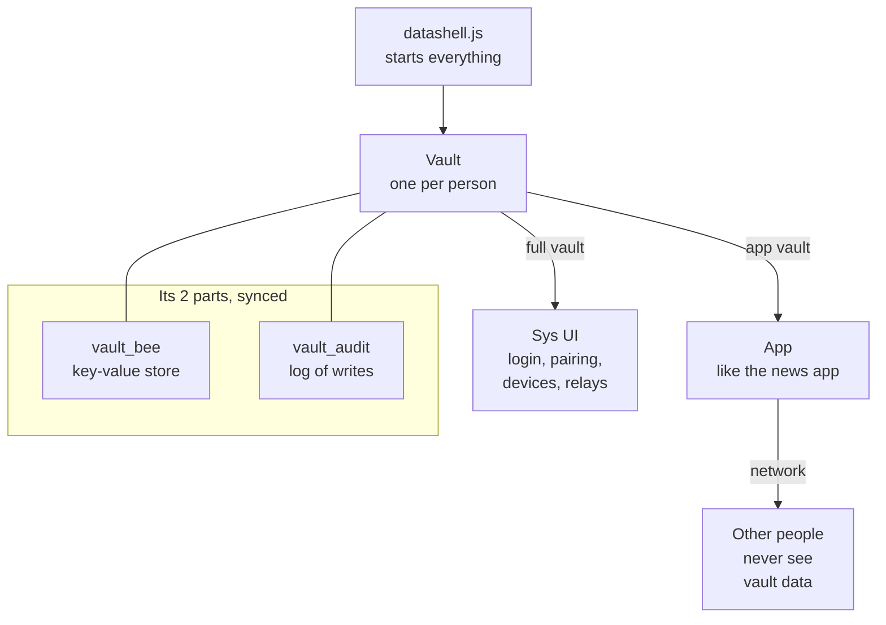
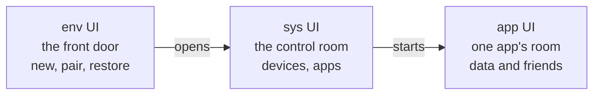
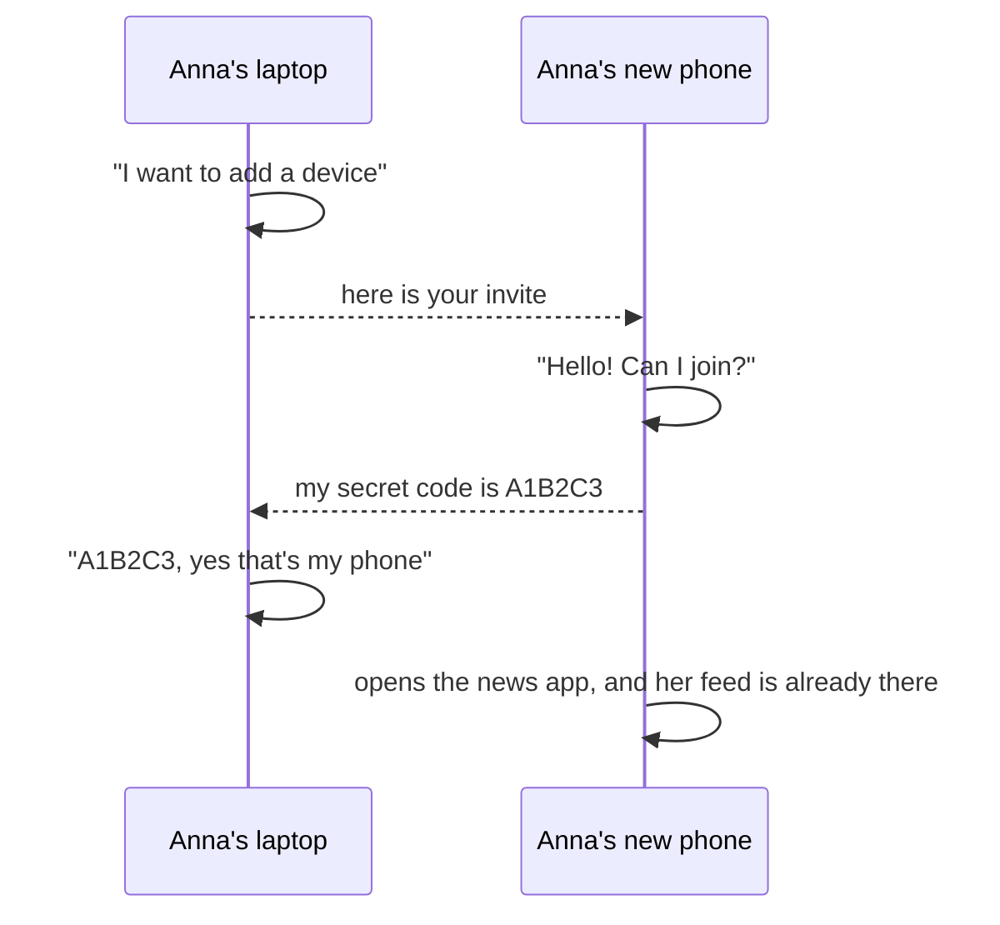

# P2P Datashell Vault API

Two parts: **what exists today** (grouped, as it is in the code right now) and an **[ideal API (draft)](#ideal-api-draft)** to work towards. Click a method to see more.

Code: [af44n/p2p-news-app @ `9df9773`](https://github.com/af44n/p2p-news-app/tree/9df97736c4612ebd4ff19c6f5e8447a12e52bed2)

---

## How to think about it

- **Datashell opens one vault per person.** That's one per browser origin, or one per folder on the command line.
- **It runs two things:**
  - **the sys UI**, which gets the **full vault**
  - **one app**, which gets a smaller **app vault**
- **The vault itself is just 2 things that sync to all your own devices:**
  - **`vault_bee`**: a key-value store that holds all records
  - **`vault_audit`**: a log of every write

**In one picture**



[Entry point: datashell.js](https://github.com/af44n/p2p-news-app/blob/9df97736c4612ebd4ff19c6f5e8447a12e52bed2/lib/datashell.js#L59-L82): it creates the vault, runs the sys UI, waits for `vault.user`, then starts the app with the app vault.

**System vault vs app vault**

| | System vault (sys UI) | App vault (e.g. the news app) |
|---|---|---|
| Gets | everything | its own small slice |
| Data keys | as written | auto-prefixed with `<profile>:<app>/` |
| Storage (`store`) | the whole vault store | a separate namespace for this app |
| Meant for | login, pairing, devices, relays, profiles | its own data, data structures, networking |
| Extra | | `username` (the profile name), `app_state` (an object kept while the page is open) |

**Labels used below:** *(env UI)* = the first screen, before login (new account, pair, restore) · *(sys UI only)* = only the sys UI gets it · *(apps)* = apps get it too

> An app only gets the methods labelled *(apps)*, plus `username`, `store` and `app_state`. Everything else is for the sys UI only.

[Where the vault is created](https://github.com/af44n/p2p-news-app/blob/9df97736c4612ebd4ff19c6f5e8447a12e52bed2/lib/node_modules/identity/index.js#L80-L160) · [Where the app vault is made](https://github.com/af44n/p2p-news-app/blob/9df97736c4612ebd4ff19c6f5e8447a12e52bed2/lib/datashell.js#L97-L126)

---

## 1. Login *(env UI)*

**Open the vault on this device, or join one from another device.** The sys UI also uses `session_*` and `reset_all_data()`, e.g. for logout and reset.

<details>
<summary><code>authenticate({ username, invite_code?, on_verification_code?, defer_resolve? })</code>: log in, or join with an invite</summary>

- **Without `invite_code`:** opens this device's vault, or creates a new one.
- **With `invite_code`:** joins the vault of another device. `on_verification_code(code)` then gives a 6-character code to type on the other device.
- **With `defer_resolve: true`:** `user` only resolves after `complete_authentication()`, e.g. once the user picked an app.

```js
vault.authenticate({ username: 'anna' })
const my_vault = await vault.user
```
[source](https://github.com/af44n/p2p-news-app/blob/9df97736c4612ebd4ff19c6f5e8447a12e52bed2/lib/node_modules/identity/index.js#L168-L226)
</details>

<details>
<summary>Join with an invite: the new device's side of pairing</summary>

The new device has no vault yet, so it joins from the env UI with the invite code from the existing device. It shows a 6-character code, the existing device types it in, and then the vault syncs.

```js
vault.authenticate({ username: 'pairing-user', invite_code, on_verification_code: code => show(code) })
vault.on_vault_ready(() => show_app_picker())   // then complete_authentication() once an app is picked
const my_vault = await vault.user
```
[source](https://github.com/af44n/p2p-news-app/blob/9df97736c4612ebd4ff19c6f5e8447a12e52bed2/lib/node_modules/identity/index.js#L171-L197)
</details>

<details>
<summary><code>user</code>: a promise that gives you the vault once login is done</summary>

It resolves to the vault object, and fails if login or pairing failed. It only resolves once, so a new login needs a page reload.

```js
const my_vault = await vault.user
vault.user.catch(err => alert('Login failed: ' + err.message))
```
[source](https://github.com/af44n/p2p-news-app/blob/9df97736c4612ebd4ff19c6f5e8447a12e52bed2/lib/node_modules/identity/index.js#L67-L71)
</details>

<details>
<summary><code>on_vault_ready(cb)</code>: called when the vault is open, before <code>user</code> resolves</summary>

The sys UI uses this to show the app picker first. Call `complete_authentication()` afterwards.

```js
vault.on_vault_ready(({ username }) => show_app_picker())
vault.authenticate({ username: 'anna', defer_resolve: true })
```
[source](https://github.com/af44n/p2p-news-app/blob/9df97736c4612ebd4ff19c6f5e8447a12e52bed2/lib/node_modules/identity/index.js#L483)
</details>

<details>
<summary><code>complete_authentication()</code>: finish login, so <code>user</code> resolves</summary>

Used after pairing, or after the user picked an app.

```js
vault.session_set_joined_app('anna:p2p-news-app')
vault.complete_authentication()
```
[source](https://github.com/af44n/p2p-news-app/blob/9df97736c4612ebd4ff19c6f5e8447a12e52bed2/lib/node_modules/identity/index.js#L228-L232)
</details>

<details>
<summary><code>session_*</code> (8 functions): small things this device remembers in localStorage</summary>

- `session_get/set_username`
- `session_get/set_joined_app`: the profile this device opened last, e.g. `anna:p2p-news-app`
- `session_get/set/clear_pending_invite`: the invite code of a device that is in the middle of pairing
- `session_clear()`: clears all of localStorage

They're in localStorage because they're per device and needed before the vault is open. **Planned:** `joined_app` moves into the vault.

```js
vault.session_set_joined_app('anna:p2p-news-app')
const last_profile = vault.session_get_joined_app()
```
[source](https://github.com/af44n/p2p-news-app/blob/9df97736c4612ebd4ff19c6f5e8447a12e52bed2/lib/node_modules/identity/index.js#L488-L495)
</details>

<details>
<summary><code>reset_all_data()</code>: delete everything on this device</summary>

Clears localStorage and the browser storage of the vault.

```js
await vault.reset_all_data()
location.reload()
```
[source](https://github.com/af44n/p2p-news-app/blob/9df97736c4612ebd4ff19c6f5e8447a12e52bed2/lib/node_modules/identity/index.js#L500-L504)
</details>

<details>
<summary>Notes: one identity per browser, mnemonic</summary>

- **One identity per browser origin for now.** Multiple accounts per browser may come later.
- **The mnemonic:** today each device makes its own mnemonic and keeps it in localStorage. This will change with mnemonic recovery: long term, only its public key stays on the device.
- **"Load from mnemonic"** is not built yet.
</details>

---

## 2. Pairing *(sys UI + env UI)*

**Add a new device to your vault.** Pairing has two sides:

- **Existing device (sys UI):** adds a new device and shares an invite code. The methods below are this side.
- **New device (env UI):** starts pairing with the invite code, see "Join with an invite" in 1. Login.

Steps: device A creates an invite → device B enters it → B shows a code → A types the code → B is added.

If pairing fails or is cancelled, device B deletes everything it had, so it can start fresh.

<details>
<summary><code>create_vault_invite()</code>: make an invite code on device A</summary>

Returns `{ invite_code, invite }`. The invite is saved in the vault, so it survives a page reload.

```js
const { invite_code, invite } = await vault.create_vault_invite()
```
[source](https://github.com/af44n/p2p-news-app/blob/9df97736c4612ebd4ff19c6f5e8447a12e52bed2/lib/node_modules/identity/index.js#L336-L352)
</details>

<details>
<summary><code>setup_vault_pairing({ invite, username, on_verification_needed, on_paired })</code>: wait for device B to connect</summary>

`on_verification_needed` fires when B connects (show the code input). `on_paired` fires when B is added.

```js
await vault.setup_vault_pairing({
  invite,
  username: 'anna',
  on_verification_needed: () => show_code_input(),
  on_paired: ({ vault_bee_writer }) => console.log('added', vault_bee_writer)
})
```
[source](https://github.com/af44n/p2p-news-app/blob/9df97736c4612ebd4ff19c6f5e8447a12e52bed2/lib/node_modules/identity/index.js#L354-L359)
</details>

<details>
<summary><code>verify_vault_pairing(code)</code>: confirm device B with the code it shows</summary>

Adds B to the vault. Throws if the code doesn't match; the sys UI then shows the error and lets you try again.

```js
try { await vault.verify_vault_pairing('A1B2C3') }
catch (err) { alert(err.message) } // wrong code: try again
```
[source](https://github.com/af44n/p2p-news-app/blob/9df97736c4612ebd4ff19c6f5e8447a12e52bed2/lib/node_modules/identity/index.js#L361-L366)
</details>

<details>
<summary><code>deny_vault_pairing()</code>: reject device B</summary>

Throws if no request is waiting, on purpose. The UI only shows Deny once a request has come in.

```js
try { vault.deny_vault_pairing() } catch (err) { alert(err.message) }
```
[source](https://github.com/af44n/p2p-news-app/blob/9df97736c4612ebd4ff19c6f5e8447a12e52bed2/lib/node_modules/identity/index.js#L368-L372)
</details>

<details>
<summary><code>cancel_vault_invite()</code>: stop pairing and delete the invite</summary>

```js
await vault.cancel_vault_invite()
```
[source](https://github.com/af44n/p2p-news-app/blob/9df97736c4612ebd4ff19c6f5e8447a12e52bed2/lib/node_modules/identity/index.js#L399-L407)
</details>

<details>
<summary><code>restore_pending_invites(config)</code>: after a reload on device A, keep waiting for B</summary>

```js
const stored = await vault.restore_pending_invites({
  username: 'anna',
  on_verification_needed: () => show_code_input(),
  on_paired: ({ vault_bee_writer }) => console.log('added', vault_bee_writer)
})
if (stored) show(stored.invite_code)
```
[source](https://github.com/af44n/p2p-news-app/blob/9df97736c4612ebd4ff19c6f5e8447a12e52bed2/lib/node_modules/identity/index.js#L378-L392)
</details>

---

## 3. Devices *(sys UI only)*

**See and manage your own devices.**

<details>
<summary><code>get_paired_devices()</code>: list your devices</summary>

Each device has a name and the time it was last online.

```js
const devices = await vault.get_paired_devices()
for (const d of devices) console.log(d.name, new Date(d.last_online))
```
[source](https://github.com/af44n/p2p-news-app/blob/9df97736c4612ebd4ff19c6f5e8447a12e52bed2/lib/node_modules/identity-operations/index.js#L206-L214)
</details>

<details>
<summary><code>get_device_name(writer_key)</code>: get one device's name</summary>

```js
const name = await vault.get_device_name(writer_key) // 'Device 2' or null
```
[source](https://github.com/af44n/p2p-news-app/blob/9df97736c4612ebd4ff19c6f5e8447a12e52bed2/lib/node_modules/identity-operations/index.js#L216-L221)
</details>

<details>
<summary><code>remove_device(device)</code>: remove a device from your vault</summary>

Takes the device object from `get_paired_devices()`. The removed device can't write anymore, and it deletes its own data when it notices.

```js
const ok = await vault.remove_device(device) // true or false
```
[source](https://github.com/af44n/p2p-news-app/blob/9df97736c4612ebd4ff19c6f5e8447a12e52bed2/lib/node_modules/identity-operations/index.js#L223-L249)
</details>

<details>
<summary>rename a device: no method, done with <code>vault_put</code></summary>

```js
await vault.vault_put(`paired_devices/${device.vault_bee_writer}`, { ...device, name: 'My Phone' })
```
</details>

<details>
<summary><code>ping_liveness()</code>: mark this device as online now</summary>

Updates `last_online`. The sys UI uses it to find devices that were offline for a long time, and decides itself what to do with them.

```js
await vault.ping_liveness()
```
[source](https://github.com/af44n/p2p-news-app/blob/9df97736c4612ebd4ff19c6f5e8447a12e52bed2/lib/node_modules/identity-operations/index.js#L261-L269)
</details>

<details>
<summary><code>on_malicious_device(cb)</code>: called when a device writes a fake log entry</summary>

`cb(writer_key)`. The sys UI then asks whether to remove that device.

```js
vault.on_malicious_device(async writer_key => {
  const devices = await vault.get_paired_devices()
  const device = devices.find(d => d.vault_audit_writer === writer_key || d.app_audit_writer === writer_key)
  if (device && confirm('Remove ' + device.name + '?')) await vault.remove_device(device)
})
```
[source](https://github.com/af44n/p2p-news-app/blob/9df97736c4612ebd4ff19c6f5e8447a12e52bed2/lib/node_modules/identity/index.js#L482)
</details>

---

## 4. Data *(apps)*

**An app's own small data: settings, lists, small records.** Keys are prefixed with the profile + app, everything syncs to your devices, and every write is logged.

<details>
<summary><code>vault_put(key, value)</code>: save a value</summary>

The value must be JSON. The write is added to the vault log.

```js
await vault.vault_put('subscribed_peers', ['ab12…'])
```
[source](https://github.com/af44n/p2p-news-app/blob/9df97736c4612ebd4ff19c6f5e8447a12e52bed2/lib/node_modules/identity-operations/index.js#L145-L153)
</details>

<details>
<summary><code>vault_get(key)</code>: read a value</summary>

Returns the value, or `null` if nothing is stored. Reads are not logged.

```js
const peers = await vault.vault_get('subscribed_peers') || []
```
[source](https://github.com/af44n/p2p-news-app/blob/9df97736c4612ebd4ff19c6f5e8447a12e52bed2/lib/node_modules/identity-operations/index.js#L155-L160)
</details>

<details>
<summary><code>vault_del(key)</code>: delete a value</summary>

```js
await vault.vault_del('subscribed_peers')
```
[source](https://github.com/af44n/p2p-news-app/blob/9df97736c4612ebd4ff19c6f5e8447a12e52bed2/lib/node_modules/identity-operations/index.js#L162-L170)
</details>

<details>
<summary><code>vault_watch(key)</code>: get notified when a value changes, also from other devices</summary>

Only on the app vault.

```js
for await (const _ of vault.vault_watch('subscribed_peers')) {
  const peers = await vault.vault_get('subscribed_peers')
}
```
[source](https://github.com/af44n/p2p-news-app/blob/9df97736c4612ebd4ff19c6f5e8447a12e52bed2/lib/datashell.js#L113)
</details>

<details>
<summary><code>on_update(cb)</code> <i>(sys UI only)</i>: called on any change in the vault</summary>

It gives no details about what changed, so re-read what you need. There is no way to unsubscribe yet.

```js
vault.on_update(() => render())
```
[source](https://github.com/af44n/p2p-news-app/blob/9df97736c4612ebd4ff19c6f5e8447a12e52bed2/lib/node_modules/identity/index.js#L481)
</details>

---

## 5. App structures *(apps)*

**Bigger data, like a feed or files.** The app creates them, and the vault remembers their keys so your other devices can find them.

<details>
<summary><code>store</code>: the app's own storage space</summary>

Data structures are created in here. Other apps' data is not in it.
</details>

<details>
<summary><code>create_ds_manager()</code> + <code>set_ds_manager(m)</code>: make the helper that creates the app's data structures</summary>

```js
const ds = vault.create_ds_manager()
vault.set_ds_manager(ds)
await ds.init_all([
  { name: 'feed', namespace: 'my-feed', type: 'autobase', encoding: 'json', view_name: 'feed-view', store: vault.store },
  { name: 'files', namespace: 'my-files', type: 'autodisk', store: vault.store }
], keys_or_null)
```
An `autobase` needs `encoding` and `view_name`. Without them, the feed has no view to read from and writers can't be added.
[source](https://github.com/af44n/p2p-news-app/blob/9df97736c4612ebd4ff19c6f5e8447a12e52bed2/lib/node_modules/datastructure-manager/index.js#L211-L225)
</details>

<details>
<summary>The structure helper's own methods (what <code>ds</code> can do)</summary>

| Method | What it does |
|---|---|
| `init_all(configs, keys?)` | create or open all structures at once (keys = open existing ones) |
| `register(config)` · `init(name, key?)` | the same, one structure at a time |
| `get(name)` | the structure itself, e.g. the feed |
| `get_key(name)` | its key, to open it on another device |
| `get_store(name)` | its own storage space |
| `get_names()` · `get_config(name)` · `get_all_configs()` | what's registered |
| `add_writer(name, key)` · `remove_writer(name, key)` | let a device write, or stop it (the vault does this for you) |
| `set(name, instance, key?)` | use a structure made somewhere else |
| `create_peer_structure({ name, peer_key, peer_key_buffer, store_instance })` | open someone else's structure to read it (autobase or autodisk) |

```js
const feed = ds.get('feed')
await feed.append({ type: 'post', data: { title: 'Hello' } })
const feed_key = ds.get_key('feed')
```
[source](https://github.com/af44n/p2p-news-app/blob/9df97736c4612ebd4ff19c6f5e8447a12e52bed2/lib/node_modules/datastructure-manager/index.js#L16-L36)
</details>

<details>
<summary><code>register_app(config)</code>: save the app and its structure keys in the vault</summary>

Called once, on the first device. It also creates the app's own log.

```js
await vault.register_app({
  name: 'My App',
  structures: [{ name: 'feed', namespace: 'my-feed', type: 'autobase', encoding: 'json', view_name: 'feed-view', key: ds.get_key('feed') }]
})
```
[source](https://github.com/af44n/p2p-news-app/blob/9df97736c4612ebd4ff19c6f5e8447a12e52bed2/lib/node_modules/identity-operations/index.js#L64-L87)
</details>

<details>
<summary><code>get_app()</code>: read the saved app record (or <code>null</code> the first time)</summary>

On another device, use it to open the same structures with the saved keys.

```js
const app = await vault.get_app()
const keys = app ? Object.fromEntries(app.structures.filter(s => s.key).map(s => [s.name, s.key])) : null
await ds.init_all(STRUCTURES.map(s => ({ ...s, store: vault.store })), keys) // keys null = create new
```
[source](https://github.com/af44n/p2p-news-app/blob/9df97736c4612ebd4ff19c6f5e8447a12e52bed2/lib/node_modules/identity-operations/index.js#L111-L116)
</details>

<details>
<summary><code>get_app_status()</code>: <code>'joined'</code>, <code>'pairing'</code> or <code>'available'</code> on this device</summary>

```js
const status = await vault.get_app_status()
if (status !== 'pairing') await vault.request_writer_access()
```
[source](https://github.com/af44n/p2p-news-app/blob/9df97736c4612ebd4ff19c6f5e8447a12e52bed2/lib/node_modules/identity-operations/index.js#L475-L480)
</details>

<details>
<summary>Writer access (3 functions): the second step of pairing, per app</summary>

A new device can read the app's data but can't write to it yet:
1. **B:** `request_writer_access()` asks for write access.
2. **A:** `start_writer_watcher()` sees the request and adds B as a writer.
3. **B:** `wait_for_writer_access()` resolves when B can write.

```js
if (feed.writable) vault.start_writer_watcher()
else { await vault.request_writer_access(); await vault.wait_for_writer_access() }
```
[source](https://github.com/af44n/p2p-news-app/blob/9df97736c4612ebd4ff19c6f5e8447a12e52bed2/lib/node_modules/identity-operations/index.js#L278-L443)
</details>

<details>
<summary><code>log_bootstrap_device()</code>: save this device's writer keys in the device list</summary>

```js
await vault.log_bootstrap_device()
```
[source](https://github.com/af44n/p2p-news-app/blob/9df97736c4612ebd4ff19c6f5e8447a12e52bed2/lib/node_modules/identity-operations/index.js#L446-L469)
</details>

<details>
<summary><code>list_apps()</code> <i>(sys UI only)</i> · <code>cancel_app_pairing(app_id)</code> <i>(sys UI only)</i>: for the sys UI's app picker</summary>

- `list_apps()` gives all apps and profiles in the vault.
- `cancel_app_pairing(app_id)` stops a waiting writer request.

```js
const apps = await vault.list_apps() // [{ id, status, name, structures }]
await vault.cancel_app_pairing('anna:p2p-news-app')
```
[source](https://github.com/af44n/p2p-news-app/blob/9df97736c4612ebd4ff19c6f5e8447a12e52bed2/lib/node_modules/identity-operations/index.js#L122-L139)
</details>

### Structure types

All four are **shared and multi-device**. They're built on Autobase, so every device ends up with the same data.

| Type | What it is | Use it for |
|---|---|---|
| **autobase** | a shared list of entries | feeds, timelines (the news feed) |
| **autodisk** | a shared folder of files | images, posts with files, packs of code |
| **autobee** | a shared key-value table | settings, records (the vault itself is one) |
| **auditcore** | a shared log that checks who wrote each entry | history, "who did what" (vault log, app logs) |

**Why more than one?** Data comes in different shapes: a list, files, a table, a history. Each type fits one shape.

**Can there be more types?** The basic ones (autobase, autodisk, autobee) stay part of datashell; auditcore is an autobase used as a log. Today all types are hard-coded, and whether apps can bring their own types later is still open.

**Built-in vs your own:** some structures every app gets automatically, like its audit log (`register_app` creates it). You only define your app's own extra structures, like a feed.

---

## 6. Network *(apps)*

**Talk to other people (not your own devices).**

<details>
<summary><code>network()</code>: get a connection to other people</summary>

Returns `{ swarm }` (`null` when offline). The app picks its own topic. Vault data is never shared on this network.

```js
const { swarm } = await vault.network()
if (swarm) swarm.join(MY_TOPIC, { server: true, client: true })
```
[source](https://github.com/af44n/p2p-news-app/blob/9df97736c4612ebd4ff19c6f5e8447a12e52bed2/lib/node_modules/identity-networking/index.js#L42-L85)
</details>

<details>
<summary>How connections work: relays in the browser only</summary>

- **Browsers can't connect peer-to-peer directly,** so they go through a WebSocket **relay**, and browser-to-browser connections fall back to WebRTC.
- **The command line and daemons** use the p2p network directly, with no relay.
- **Your own devices sync on a separate network,** which `authenticate` sets up.
</details>

<details>
<summary><code>get_current_relay()</code> <i>(sys UI only)</i> + relay settings: which relay the browser uses</summary>

The relay list and the default relay are saved in the vault. The sys UI's Relays tab edits them.

```js
const relay = vault.get_current_relay()
```
[source](https://github.com/af44n/p2p-news-app/blob/9df97736c4612ebd4ff19c6f5e8447a12e52bed2/lib/websys-ui.js#L604-L641)
</details>

---

## 7. Logs and debug

**See what happened, and inspect the raw data.**

<details>
<summary><code>get_vault_audit()</code> <i>(sys UI only)</i>: the vault's log of every write</summary>

```js
const entries = await vault.get_vault_audit().read()
```
[source](https://github.com/af44n/p2p-news-app/blob/9df97736c4612ebd4ff19c6f5e8447a12e52bed2/lib/node_modules/identity/index.js#L436)
</details>

<details>
<summary><code>get_app_audit()</code> · <code>load_app_audit(key)</code> <i>(apps)</i>: an app's own log</summary>

Each app has its own log of what it did.

```js
const app = await vault.get_app()
await vault.load_app_audit(app.audit_key) // on another device, once
const entries = await vault.get_app_audit().read()
```
[source](https://github.com/af44n/p2p-news-app/blob/9df97736c4612ebd4ff19c6f5e8447a12e52bed2/lib/node_modules/identity-operations/index.js#L93-L105)
</details>

<details>
<summary><code>get_raw_data(name)</code> <i>(apps)</i>: dump a data structure as text</summary>

For debugging.

```js
console.log(await vault.get_raw_data('feed'))
```
[source](https://github.com/af44n/p2p-news-app/blob/9df97736c4612ebd4ff19c6f5e8447a12e52bed2/lib/node_modules/identity-operations/index.js#L497-L504)
</details>

<details>
<summary><code>get_network_diagnostics()</code> · <code>get_performance_samples()</code> · <code>on_performance_sample(cb)</code> <i>(sys UI only)</i>: connection and speed info</summary>

Shown in the sys UI's Net and Performance tabs.

```js
const networks = vault.get_network_diagnostics()
vault.on_performance_sample(sample => draw(sample))
```
[source](https://github.com/af44n/p2p-news-app/blob/9df97736c4612ebd4ff19c6f5e8447a12e52bed2/lib/node_modules/identity/index.js#L460-L475)
</details>

<details>
<summary><code>set_events_drive</code> <i>(apps)</i> · <code>log_event</code>, <code>get_events</code>, <code>get_events_drive</code>, <code>get_events_store</code> <i>(sys UI only)</i>: older event log in an app's folder</summary>

Probably replaced by the audit logs over time.

```js
// app: hand its events folder to the vault
vault.set_events_drive(ds.get('events'), ds.get_store('events'))
// sys UI: write and read events
const drive = vault.get_events_drive()
await vault.log_event(drive, 'add', { name: 'Device 2' })
const events = await vault.get_events(drive)
```
[source](https://github.com/af44n/p2p-news-app/blob/9df97736c4612ebd4ff19c6f5e8447a12e52bed2/lib/node_modules/identity-operations/index.js#L176-L200)
</details>

---

## Internal: should not be public

These grew with the news app and were only meant for internal use. Apps don't get them.

<details>
<summary>9 internal getters, setters and helpers</summary>

| Method | What it gives or changes |
|---|---|
| `get_vault_bee()` | the raw key-value store of the whole vault |
| `get_swarm()` · `set_swarm()` | the network for your own devices |
| `get_dht()` · `set_dht()` | the low-level network |
| `get_ds_manager()` | the current app's structure helper |
| `set_pairing_manager()` | the pairing helper |
| `init_vault_structures()` | opens the vault's two parts (done by `authenticate`) |
| `config` | the options the vault was started with |

```js
const bee = vault.get_vault_bee() // sys UI only
```
[source](https://github.com/af44n/p2p-news-app/blob/9df97736c4612ebd4ff19c6f5e8447a12e52bed2/lib/node_modules/identity/index.js#L413-L438)
</details>

---

## Bugs

Still open in the latest code.

1. **Lowercase verification codes fail.** The code is shown in uppercase (`A1B2C3`), but the web UI and the CLI don't uppercase what the user types, so `a1b2c3` is rejected with "code does not match". [web](https://github.com/af44n/p2p-news-app/blob/9df97736c4612ebd4ff19c6f5e8447a12e52bed2/lib/websys-ui.js#L718) · [cli](https://github.com/af44n/p2p-news-app/blob/9df97736c4612ebd4ff19c6f5e8447a12e52bed2/lib/clisys-ui.js#L309)
2. **`get_current_relay()` can show the wrong relay.** It returns `config.relay || 'ws://localhost:8080'`, and `config.relay` is never set, so the Relays tab can show a different relay than the one in use. The connection itself is not affected. [source](https://github.com/af44n/p2p-news-app/blob/9df97736c4612ebd4ff19c6f5e8447a12e52bed2/lib/node_modules/identity/index.js#L438)
3. **Logout also deletes the device's seedphrase.** `session_clear()` empties all of localStorage, including `vault-seedphrase`, so the next login creates a new device key. The vault data stays. To confirm with Lupay, since the mnemonic work will change this part. [source](https://github.com/af44n/p2p-news-app/blob/9df97736c4612ebd4ff19c6f5e8447a12e52bed2/lib/websys-ui.js#L415)

---

## Ideal API (draft)

**An idea for a simpler vault API, to discuss and change step by step.** Some parts can only be decided once we try them in code. Click a method to see an example and what it replaces today.

<details>
<summary>The rules we follow (6)</summary>

1. **A 5-year-old should understand the names.** Use everyday words: `devices`, `apps`, `list`, `rename`, `history`.
2. **Three places, three keys.** Each place only gets what it needs, and nothing else.
3. **Local first, p2p when needed.** Apps work offline with the same API. Datashell quietly makes things p2p only when you share, go online, or add a device.
4. **Few methods, each doing more.** Group them by what you want to do, not by how the code works.
5. **The inside stays hidden.** Apps never see keys, writers, stores or swarms unless they really need them.
6. **STATE.js first.** Where STATE.js already has a good way of doing something, the vault follows it.
</details>

### Three places



| Place | Like… | What happens there | Gets |
|---|---|---|---|
| **env UI** | a front door | make a new account, pair with your other device, or restore one | `datashell.start()` |
| **sys UI** | a control room (like a wallet) | manage your devices, apps, relays and history | the full `vault` |
| **app UI** | one room (like a dApp) | the app keeps its own data and talks to other people | a small `vault` |

In the current code these are `vault` (before login), `vault.user` and the app vault.

### A. Front door *(env UI)*

**One call opens your vault: new, paired, or restored.**

<details>
<summary><code>datashell.start({ name })</code>: open this device's account, or make a new one</summary>

```js
const vault = await datashell.start({ name: 'anna' })
```
**Replaces:** `authenticate({ username })` + `await vault.user`. Hidden inside: `session_*`, `init_vault_structures`, `defer_resolve`.
</details>

<details>
<summary><code>datashell.start({ pair, on_code })</code>: join the account on your other device</summary>

```js
const vault = await datashell.start({ pair: invite_code, on_code: code => show(code) })
```
**Replaces:** `authenticate({ username: 'pairing-user', invite_code, on_verification_code })` + `on_vault_ready` + `complete_authentication()`.
</details>

<details>
<summary><code>datashell.start({ restore })</code>: bring back your account from your words (later)</summary>

```js
const vault = await datashell.start({ restore: words })
```
**Replaces:** not built yet ("Load from mnemonic"). Later the front door could also offer `datashell.accounts()` to pick one of several accounts, with a password.
</details>

### B. Control room *(sys UI)*

**Everything about you and your devices.**

<details>
<summary><code>vault.devices.invite()</code>: let a new device join</summary>

```js
const invite = await vault.devices.invite()   // invite.code: give this to the new device
await invite.accept('A1B2C3')                 // or invite.reject() / invite.cancel()
```
**Replaces:** `create_vault_invite()` + `setup_vault_pairing()` + `verify_vault_pairing()` / `deny_vault_pairing()` / `cancel_vault_invite()`. Hidden: `restore_pending_invites()`. `accept` also takes lowercase codes.
</details>

<details>
<summary><code>vault.devices.list()</code>: see your devices</summary>

```js
const devices = await vault.devices.list()
```
**Replaces:** `get_paired_devices()` · `get_device_name()`.
</details>

<details>
<summary><code>vault.devices.rename(device, name)</code>: give a device a name</summary>

```js
await vault.devices.rename(device, 'My Phone')
```
**Replaces:** `vault_put('paired_devices/…', { ...device, name })`.
</details>

<details>
<summary><code>vault.devices.remove(device)</code>: take a device out</summary>

```js
await vault.devices.remove(device)
```
**Replaces:** `remove_device(device)`. (`ping_liveness()` stays hidden too: it runs on its own at every login.)
</details>

<details>
<summary><code>vault.apps.list()</code> · <code>open(id)</code> · <code>close()</code> · <code>reset(id)</code>: your apps and profiles</summary>

```js
const apps = await vault.apps.list()
await vault.apps.open('anna:p2p-news-app')
```
**Replaces:** `list_apps()` · `session_set_joined_app(id)` + `complete_authentication()` · `session_set_joined_app('')` + reload · deleting the app's records by hand. Hidden: `cancel_app_pairing()`.
</details>

<details>
<summary><code>vault.relays.list()</code> · <code>add(url)</code> · <code>remove(url)</code> · <code>use(url)</code>: which relay the browser uses</summary>

```js
await vault.relays.add('wss://my-relay.example')
await vault.relays.use('wss://my-relay.example')
```
**Replaces:** `vault_get/put('config/relays' …)` · `get_current_relay()`.
</details>

<details>
<summary><code>vault.history()</code>: who did what, on which device</summary>

```js
const entries = await vault.history()
```
**Replaces:** `get_vault_audit().read()`.

This is the **whole vault's** history. Apps have their own `vault.history()` with only **that app's** history (see the app room).
</details>

<details>
<summary><code>vault.on('change' | 'danger', cb)</code> · <code>vault.status()</code>: news about your vault</summary>

```js
vault.on('danger', device => ask_to_remove(device))
const info = vault.status()
```
**Replaces:** `on_update(cb)` (and it can be turned off again) · `on_malicious_device(cb)` · `get_network_diagnostics()` · `get_performance_samples()`.
</details>

<details>
<summary><code>vault.reset()</code>: delete everything on this device</summary>

```js
await vault.reset()
```
**Replaces:** `reset_all_data()`.
</details>

### C. App room *(app UI)*

**An app only needs four things: small data, bigger data, its own history, and friends.**

<details>
<summary><code>vault.data.put / get / remove / watch</code>: small data, like settings</summary>

```js
await vault.data.put('theme', 'dark')
const theme = await vault.data.get('theme')
vault.data.watch('theme', value => render(value))
```
**Replaces:** `vault_put` · `vault_get` · `vault_del` · `vault_watch(key)` + a `for await` loop + `vault_get`.
</details>

<details>
<summary><code>vault.list(name)</code> · <code>vault.folder(name)</code> · <code>vault.table(name)</code>: bigger data, asked for by its shape</summary>

```js
const feed  = await vault.list('feed')      // a list of entries, like a timeline
const files = await vault.folder('files')   // a folder of files
const prefs = await vault.table('prefs')    // a key-value table
await feed.add({ title: 'Hello' })
```
No setup. The first time you ask, it's created. On your other devices, the same name opens the same data. Writing from a new device just works.

**Replaces:** autobase / autodisk / autobee via `create_ds_manager()` + `set_ds_manager()` + `init_all()`. Hidden: `register_app()`, `get_app()`, `request_writer_access()`, `wait_for_writer_access()`, `start_writer_watcher()`, `get_app_status()`, `log_bootstrap_device()`, and `namespace`, `encoding`, `view_name`, `store`.
</details>

<details>
<summary><code>vault.history()</code>: the app's own history (built in)</summary>

```js
const entries = await vault.history()
```
Every app gets one automatically. The app doesn't create it. It only shows **this app's** history, not the whole vault's (that one is in the control room).

**Replaces:** `get_app_audit().read()` · `load_app_audit(key)` · `set_events_drive()` and the events folder the app makes itself.
</details>

<details>
<summary><code>vault.connect(room)</code>: meet other people</summary>

```js
const room = await vault.connect('news')
room.on('friend', friend => say_hi(friend))
```
Your own devices are never part of this, and vault data is never shared here.

**Replaces:** `network()` + `swarm.join(topic)` with a 32-byte topic.
</details>

<details>
<summary>Before and after: an app starting up</summary>

**Current code**, in the news app:

```js
const ds = vault.create_ds_manager()
vault.set_ds_manager(ds)
vault.start_writer_watcher()
const app = await vault.get_app()
if (app) {
  const keys = Object.fromEntries(app.structures.filter(s => s.key).map(s => [s.name, s.key]))
  await ds.init_all(STRUCTURES.map(s => ({ ...s, store: vault.store })), keys)
  if (!ds.get('metadata').writable) {
    if (await vault.get_app_status() !== 'pairing') await vault.request_writer_access()
    vault.wait_for_writer_access()
  }
} else {
  await ds.init_all(STRUCTURES.map(s => ({ ...s, store: vault.store })))
  await vault.register_app({ name: 'P2P News App', structures: /* ... */ })
}
vault.set_events_drive(ds.get('events'), ds.get_store('events'))
await vault.log_bootstrap_device()
const { swarm } = await vault.network()
```

**Idea:**

```js
const feed  = await vault.list('feed')
const files = await vault.folder('files')
const room  = await vault.connect('news')
```
</details>

### Open questions

1. **What goes where?** Small data (`data.put`), bigger data (`list`, `folder`, `table`), or STATE's `sdb.drive`?
2. **STATE.js:** each component has its own nested `sdb` with its own `sdb.drive` (maybe renamed `sdb.disk`). How do those map to the vault? Either way, the app shouldn't be able to tell.
3. **One disk per app, or one per component?** Waiting on Lupay.
4. **net.js:** how does `vault.connect()` fit with net.js and `io`?
5. **Local first:** where exactly does the upgrade to p2p happen (`sdb.drive`, `io`)?
6. **Types:** `list`, `folder` and `table` stay built in. Can apps bring their own types later?
7. **Names:** are `list`, `folder`, `table` and `connect` clear enough? Better ideas welcome.

### A tiny story: Anna gets a new phone

Anna loves reading news on her laptop. Today a shiny new phone arrives, and she wants her news on it too. No cables, no copying, no "please wait while we set things up". Just four little steps:



<details>
<summary>The same story in code (4 lines)</summary>

```js
// 1. On the laptop: "I want to add a device"
const invite = await vault.devices.invite()

// 2. On the phone: Anna types the invite, and the phone shows a short code
await datashell.start({ pair: invite.code, on_code: code => show(code) })   // shows "A1B2C3"

// 3. On the laptop: Anna types the code she sees on the phone
await invite.accept('A1B2C3')

// 4. On the phone, in the news app: her feed is just there
const feed = await vault.list('feed')
```

No keys, no writer requests, no setup. The phone can read **and** write her feed straight away. With the current code, the same thing needs more than 10 different methods, from `create_vault_invite` to `request_writer_access`.
</details>
