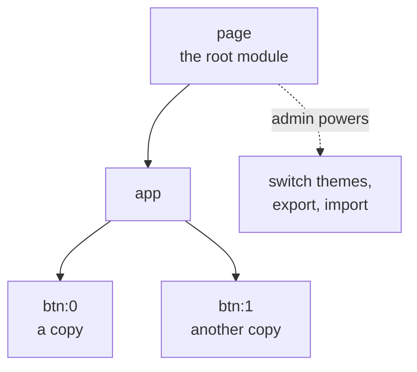

# STATE.js, net.js and DOCS.js in simple words

What the frontend side of datashell can do today, checked against the code ([playproject-io/datashell @ `7976541`](https://github.com/playproject-io/datashell/tree/7976541ff36f2b7b1c237873aae4104d8f079d1e); DOCS.js is in [ddroid/ui-components @ `e2879e9`](https://github.com/ddroid/ui-components/tree/e2879e95dbb5ba8a29851422a85c8d37ad1f881b)).

---

## The big picture

- **An app is a family tree of modules.** A module can be used more than once, and each copy is an **instance** (`page>app>btn:0`).
- **Each module says what it starts with** (its **fallback**). A parent can **change what its child starts with** (an **override**).
- **Each module and instance gets an `sdb`:** its own small folder of files (the **drive**), and it's told when they change.
- **The root module** (usually `page`) has extra **admin** powers: switch themes, add, export and import data.
- **Everything is saved in the browser** (`localStorage`). Nothing is p2p yet.
- **Parts talk with messages** through **net.js**.
- **DOCS.js** gives parts a **help mode**: clicking shows what a button does instead of doing it.

---

## STATE.js

| You want to… | You call |
|---|---|
| say "I am a module" | `const statedb = STATE(__filename)` |
| (root only) open the database | `statedb.admin()` |
| give your defaults, get your tools | `const { sdb, get } = statedb(fallback_module)` |
| open one copy | `const { id, sdb } = await get(sid)` |
| be told when your files change | `await sdb.watch(onbatch)` |
| read / write / list your files | `sdb.drive.get(path)` · `put(path, content)` · `list(folder)` · `has(path)` |
| peek into a child's files (read only) | `sdb.get(sid)` |
| (root only) switch, add, export, import | `sdb.admin.swtch()` · `register()` · `export_db()` · `import_db()` … |

The drive has only these 4 methods. There's no delete.

## net.js

- **Each part gets `net(id)` → `{ io, _ }`.** A parent invites a child (`io.invite`), the child accepts (`io.accept`), then each sends with `_[name](type, data, refs)`.
- **A message looks like** `{ head: [from, to, number], refs, type, data, meta }`. A reply points back with `refs: { cause: msg.head }`.
- **There's also an `io.js`** that STATE gives out. It's a different thing with the same name.
- **Ahmad's newer net.js** only adds one line (no two connections with the same name).
- **The news app's own copy (`net_helper`) is different:** it sends `(type, refs, data)` instead of `(type, data, refs)`. Switching it to datashell's net.js as it is would mix up message contents.

## DOCS.js

- **A help-mode switch.** Each component lists its actions with a help text, and wraps its click handlers. In help mode, a click shows the help text.
- **It doesn't use STATE at all** (no `sdb`, `drive` or `io`), and it isn't part of datashell yet.

---

## Where Ahmad's summary is out of date

- It says STATE.js has 1,244 lines; it now has 1,424. Its line numbers are off.
- It names functions that no longer exist (`check_version`, `validate_and_preprocess`), and misses some admin methods (`import_root`, `export_root`, `get_dataset`, …).
- It doesn't say `sdb.get(sid)` is read only, or that reloading the page clears the saved data when running through the shim.

---

## Bugs found (checked in the code)

1. **3 admin methods crash:** `unregister`, `import_db` and `import_root` call functions they can't reach ([L1146](https://github.com/playproject-io/datashell/blob/7976541ff36f2b7b1c237873aae4104d8f079d1e/lib/node_modules/STATE.js#L1146), [L1163](https://github.com/playproject-io/datashell/blob/7976541ff36f2b7b1c237873aae4104d8f079d1e/lib/node_modules/STATE.js#L1163), [L1169](https://github.com/playproject-io/datashell/blob/7976541ff36f2b7b1c237873aae4104d8f079d1e/lib/node_modules/STATE.js#L1169)).
2. **A typo (`${subi,d}`) turns an error message into a crash** ([L1279](https://github.com/playproject-io/datashell/blob/7976541ff36f2b7b1c237873aae4104d8f079d1e/lib/node_modules/STATE.js#L1279)).
3. **After switching themes, the drive reads one dataset but writes another.**
4. **A new version clears all of `localStorage`,** not only STATE's own data ([L780-L783](https://github.com/playproject-io/datashell/blob/7976541ff36f2b7b1c237873aae4104d8f079d1e/lib/node_modules/STATE.js#L780-L783)).
5. **Debug leftovers:** a `LESEZEICHEN:` label and a `debugger` ([L254](https://github.com/playproject-io/datashell/blob/7976541ff36f2b7b1c237873aae4104d8f079d1e/lib/node_modules/STATE.js#L254), [L260](https://github.com/playproject-io/datashell/blob/7976541ff36f2b7b1c237873aae4104d8f079d1e/lib/node_modules/STATE.js#L260)).
6. **net.js:** messages passed through more than one hop always fail.
7. **DOCS.js:** it throws when a component has no actions.

---

## What the vault gives vs. what `sdb` has

| The app vault gives | `sdb` today | Missing |
|---|---|---|
| save / read small data (`vault_put` / `vault_get`) | partly: `sdb.drive.put` / `get` | not synced |
| delete (`vault_del`) | ❌ | the drive has no delete |
| watch for changes (`vault_watch`) | partly: `sdb.watch` | only this browser |
| its own storage space (`store`) | ❌ | no p2p storage behind `sdb` |
| data structures (`create_ds_manager` …) | ❌ | — |
| remember the app and its keys (`register_app`, `get_app`) | ❌ | — |
| the app's history (`get_app_audit`) | ❌ | — |
| let a new device write (writer access) | ❌ | — |
| networking (`network`) | partly: net.js | only inside one page |
| docs | ❌ | DOCS isn't part of `sdb` |

**Good news:** `statedb.admin()` already accepts a different database instead of the browser one. So the storage can be swapped without changing every module.

## Ideas for the first STATE.js pull request

1. Fix the crash bugs and remove the debug leftovers (bugs 1, 2, 5).
2. Add `sdb.drive.del(path)`.
3. Fix the read/write mix-up and only clear STATE's own data (bugs 3, 4).
4. Write down what a custom database must provide, so a vault-backed one can be written next.
5. Then the first p2p step: a database that saves into the vault instead of the browser.

Steps 1–3 fix STATE.js as it is. Steps 4–5 start connecting it to the p2p vault.

---

**Not checked:** nothing was run, everything comes from reading the code. Ahmad's "state-architecture" page (with its verification matrix) is still missing.
